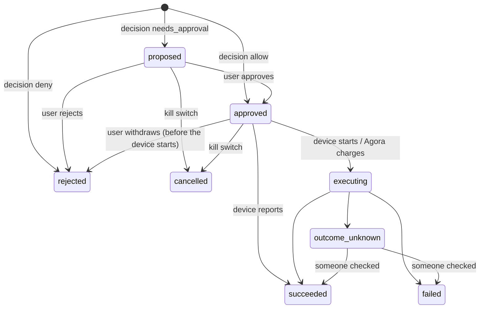

# Agent commerce API

The trust layer between the on-device agent and money. The agent **proposes** what it wants to do (an
*intent*). A deterministic policy engine (`backend/app/core/policy.py`) **decides**: allow, ask the user, or
refuse, with plain-language reasons the app shows as-is. Users grant spending authority as *mandates*,
modeled on the spending limits and controls of Visa Intelligent Commerce agent credentials. One button (the
kill switch) revokes all of it. Every state change goes to the hash-chained audit log.

All routes need `Authorization: Bearer <token>` and return RFC 7807 `application/problem+json` errors.
Changes publish events on `GET /v1/events`: `agent.updated` (intents and mandates), `budget.updated` and
`spend.updated`. Each event carries only an `id`; refetch the resource.

The examples below were captured before the dedicated demo account was introduced. Their shapes still
apply, but simulated checkout now requires the designated demo account (`demo` login, Alex Rivera).
Ordinary accounts never receive simulated payments. IDs and timestamps will differ.

## Contents

- [Endpoints](#endpoints)
- [Concepts](#concepts)
- [Intent lifecycle](#intent-lifecycle)
- [How decisions are made](#how-decisions-are-made)
- [Mandates](#mandates)
- [Proposing an intent](#proposing-an-intent)
- [Approve, reject, report the outcome](#approve-reject-report-the-outcome)
- [Agora checkout and payments](#agora-checkout-and-payments)
- [Kill switch](#kill-switch)
- [Budgets and spend](#budgets-and-spend)
- [Audit trail](#audit-trail)
- [Errors](#errors)
- [Fitting the iOS agent](#fitting-the-ios-agent)
- [Security notes](#security-notes)

## Endpoints

| Route | Who calls it | What it does |
|---|---|---|
| `POST /v1/agent/intents` | agent | Propose an action and get the decision. **`Idempotency-Key` required** |
| `GET /v1/agent/intents?status=proposed` | app | Household agent activity, newest first. Repeat `status` to filter (the approval inbox is `status=proposed`) |
| `GET /v1/agent/intents/{id}` | both | One intent |
| `POST /v1/agent/intents/{id}/approve` | app | User approves an escalated intent. Agora checkouts are charged right away |
| `POST /v1/agent/intents/{id}/reject` | app | User says no, optionally with a `reason_code` |
| `POST /v1/agent/intents/{id}/outcome` | agent | Device reports `executing`, `succeeded`, `failed` or `outcome_unknown` |
| `GET /v1/agent/mandates` | app | Your mandates with spend this period. `include_inactive=true` adds revoked and expired ones |
| `POST /v1/agent/mandates` | app | Grant spending authority |
| `DELETE /v1/agent/mandates/{id}` | app | Revoke a mandate (soft: status `revoked`) |
| `GET /v1/agent/state` | both | Autonomy level, paused or not, active mandates, approvals waiting |
| `POST /v1/agent/pause` | app | **Kill switch**: pause, revoke all mandates, cancel everything not yet started |
| `POST /v1/agent/resume` | app | Lift the pause. Mandates stay revoked |
| `GET /v1/budgets` | app | Budgets with spent, pending and remaining for the current period |
| `POST /v1/budgets` | app | Create a weekly or monthly budget, overall or per category |
| `PATCH /v1/budgets/{id}` | app | Change `limit_cents`, or archive/restore with `status` |
| `GET /v1/spend?period=month&group=category` | app | This week's or month's spend grouped by `category`, `merchant` or `none`, plus budget headroom |

List and create routes take an optional `household_id` (query parameter for `GET`, body field for `POST`).
It defaults to the user's first household.

## Concepts

- **Autonomy level** (existing `PATCH /v1/me/settings` field `autonomy_level`) sets the ceiling:

  | Level | Purchases | `list_add`, `add_to_cart`, `calendar_event` |
  |---|---|---|
  | `inform` | refused | refused (the agent only suggests) |
  | `prepare` | always ask | allowed |
  | `buy_with_approval` | always ask | allowed |
  | `buy_within_mandate` | allowed if a mandate fits and every check passes, otherwise ask | allowed |

- **Mandate**: one user's grant of spending authority in one household. It has a scope (merchants and/or
  categories, or anything), a per-purchase cap, an optional cap per day, week or month, an optional "still ask
  me above $X" threshold, and a mandatory expiry (30 days by default, at most a year). Mandates are personal:
  other household members can't see yours.
- **Intent**: one thing the agent wants to do, with the model's `rationale` and `evidence` and the engine's
  `decision`, `decision_reasons` (user-facing strings) and `reason_codes` (stable codes for the UI).
  Intents are visible to the whole household, so everyone can see what an agent does with shared money. Only
  the person whose agent made one can approve, reject or report on it.
- **Execution**: `device` (default) means the on-device browser agent acts on a third-party site in the
  visible browser with the user's own session, then reports the outcome. `agora` means the server charges a
  tokenized payment method through a `PaymentProvider` (purchases only).

## Intent lifecycle



- `decision` never changes after the proposal. It records what the policy said; `decided_by` records who
  moved it on (`policy`, `user` or `kill_switch`).
- A proposed intent can be approved for 24 hours (`approval_expires_at`). After that, approving returns
  `409 approval_expired`, and the agent should propose again with fresh facts.
- `outcome_unknown` is never retried automatically. A later request for the same item is escalated with
  `duplicate_unknown` so a person checks first.

## How decisions are made

`decide(intent, settings, mandates, budgets, recent_intents, now)` is a pure function with a table-driven
test suite (`backend/tests/test_policy.py`). Same inputs, same answer. Checks run in this order:

| Code | Outcome | Message (examples are verbatim) |
|---|---|---|
| `agent_paused` | deny | "You paused your agent. Resume it to let it act again." |
| `autonomy_inform` | deny | "Your agent is set to Inform, so it can suggest things but not act on them." |
| `autonomy_allows` | allow | "Buy within mandate lets your agent add things to your lists without asking." (non-purchases) |
| `missing_amount` | deny | A purchase without a price (the API also rejects it with 422) |
| `duplicate_pending` | deny | "'Jam' is already waiting for approval or being bought." (same item, anyone in the household) |
| `velocity_limit` | deny | "Your agent already asked to buy 3 things in the last hour, which is the limit. Try again later or buy it yourself." |
| `duplicate_recent` | ask | "'Oat milk' was already bought 3 hours ago." (same item succeeded in the last 7 days) |
| `duplicate_unknown` | ask | "An order for 'Bagels' placed just now may have gone through. Check before buying again." |
| `over_budget` | ask | "This would take your monthly dairy budget to $62.98 of $60.00." |
| `within_budget` | (info) | "$51.02 left in your monthly dairy budget after this." |
| `autonomy_requires_approval` | ask | "Your agent is set to Buy with approval, so every purchase needs your OK." |
| `no_mandate` | ask | "You haven't given your agent a spending mandate, so it needs your OK." |
| `outside_mandate` | ask | "None of your mandates cover 'Ribeye steaks' at Safeway (meat)." |
| `mandate_expired` | ask | "Your 'Groceries' mandate expired on Oct 1. Renew it to let the agent buy on its own." |
| `over_txn_cap` | ask | "$54.00 is over the $50.00 per-purchase limit in your 'Weekly groceries' mandate." |
| `confirm_above` | ask | "Your 'Weekly groceries' mandate asks you to confirm purchases over $30.00." |
| `over_period_cap` | ask | "This would bring 'Groceries' to $203.99 this month, over its $200.00 limit." |
| `within_mandate` | (info) | "Within your 'Weekly groceries' mandate: $8.98 of $50.00 allowed per purchase." |
| `mandate_period_left` | (info) | "$141.02 left on 'Weekly groceries' this week after this." |

Details:

- **Velocity** counts this user's purchase requests in the last hour that weren't refused or cancelled by the
  kill switch, including ones the user later rejected. A runaway loop gets cut off rather than filling the inbox.
- **Budgets** count recorded spend (`spend_entries`) plus agent purchases that are approved, executing or
  `outcome_unknown` but not yet recorded. Both overall and category budgets apply.
- **Period caps** count purchases made under that mandate (approved through succeeded, at the final amount
  when known). Periods are calendar days, weeks (Monday) and months in the user's time zone.
- When several mandates are in scope, the first one (oldest) that fits wins. If none fits, the reasons
  come from the first one in scope.
- Escalation reasons come first, then the informational ones, so the first line of an approval sheet is
  always why the agent is asking.

## Mandates

### Create

```http
POST /v1/agent/mandates
```

```json
{
  "label": "Weekly groceries",
  "merchant_ids": ["cef0d416-84ef-4ccc-8d62-3081c817ce40"],
  "categories": ["dairy", "produce"],
  "max_per_txn_cents": 5000,
  "max_per_period_cents": 15000,
  "period": "week",
  "require_confirm_above_cents": 3000,
  "expires_in_days": 30
}
```

`201 Created`:

```json
{
  "id": "b0dc5e4a-95c6-4da3-9e24-ff67cc712710",
  "household_id": "8f25c7bf-8bfa-488d-96b6-fad6bad46a3b",
  "label": "Weekly groceries",
  "merchant_ids": ["cef0d416-84ef-4ccc-8d62-3081c817ce40"],
  "categories": ["dairy", "produce"],
  "currency": "USD",
  "max_per_txn_cents": 5000,
  "max_per_period_cents": 15000,
  "period": "week",
  "require_confirm_above_cents": 3000,
  "expires_at": "2026-11-17T00:38:53.175944Z",
  "status": "active",
  "revoked_at": null,
  "revoked_reason": null,
  "period_started_at": "2026-10-12T00:00:00-07:00",
  "spent_this_period_cents": 0,
  "created_at": "2026-10-18T00:38:53.177215Z"
}
```

| Field | Rules |
|---|---|
| `label` | 1-60 characters, shown in reasons ("your 'Weekly groceries' mandate") |
| `merchant_ids` | optional, 1-20 merchants you can see (global catalog or your household's; find-or-create them with `POST /v1/merchants`). Omit for any merchant |
| `categories` | optional, 1-20, lowercased. Omit for any category |
| `max_per_txn_cents` | required, 1 to 10,000,000 |
| `max_per_period_cents` | optional, at least `max_per_txn_cents` |
| `period` | `day`, `week` or `month` (default `month`) |
| `require_confirm_above_cents` | optional: still ask above this amount |
| `expires_at` / `expires_in_days` | one or neither (default 30 days). Must be within a year; `expires_at` needs an offset |

A mandate only takes effect at autonomy `buy_within_mandate` and while the agent isn't paused. `status` is
`active`, `expired` (computed from `expires_at`) or `revoked`.

### Revoke

`DELETE /v1/agent/mandates/{id}` returns the mandate with `"status": "revoked", "revoked_reason": "user"`.
Revoking again is a no-op. Mandates are never hard-deleted, so past intents still point at the mandate that
allowed them.

## Proposing an intent

```http
POST /v1/agent/intents
Idempotency-Key: c0ffee00-oat-milk-1
```

```json
{
  "kind": "purchase",
  "title": "Oat milk, 2 cartons",
  "amount_cents": 898,
  "quantity": 2,
  "merchant_id": "cef0d416-84ef-4ccc-8d62-3081c817ce40",
  "category": "dairy",
  "url": "https://ballardmarket.example/oat-milk",
  "rationale": "One carton left; you go through about two a week.",
  "evidence": [
    {"kind": "inventory_low", "detail": "1 carton in the fridge (scan, 2 days ago)"},
    {"kind": "runout_forecast", "detail": "Runs out Thu (Wed-Fri)"}
  ]
}
```

`201 Created`, allowed within the mandate (and a monthly dairy budget):

```json
{
  "id": "02eeba9f-deab-4596-bbab-7139df979223",
  "household_id": "8f25c7bf-8bfa-488d-96b6-fad6bad46a3b",
  "kind": "purchase",
  "execution": "device",
  "title": "Oat milk, 2 cartons",
  "payload": {"url": "https://ballardmarket.example/oat-milk", "quantity": 2},
  "amount_cents": 898,
  "final_amount_cents": null,
  "currency": "USD",
  "merchant_id": "cef0d416-84ef-4ccc-8d62-3081c817ce40",
  "merchant_name": "Ballard Market",
  "category": "dairy",
  "rationale": "One carton left; you go through about two a week.",
  "evidence": [
    {"kind": "inventory_low", "detail": "1 carton in the fridge (scan, 2 days ago)"},
    {"kind": "runout_forecast", "detail": "Runs out Thu (Wed-Fri)"}
  ],
  "decision": "allow",
  "decision_reasons": [
    "Within your 'Weekly groceries' mandate: $8.98 of $50.00 allowed per purchase.",
    "$141.02 left on 'Weekly groceries' this week after this.",
    "$51.02 left in your monthly dairy budget after this."
  ],
  "reason_codes": ["within_mandate", "mandate_period_left", "within_budget"],
  "mandate_id": "b0dc5e4a-95c6-4da3-9e24-ff67cc712710",
  "status": "approved",
  "decided_by": "policy",
  "decided_at": "2026-10-18T00:39:44.472384Z",
  "reject_reason": null,
  "error_code": null,
  "order_id": null,
  "mine": true,
  "approval_expires_at": null,
  "created_at": "2026-10-18T00:39:44.472384Z",
  "updated_at": "2026-10-18T00:39:44.472384Z",
  "completed_at": null
}
```

Retrying with the same `Idempotency-Key` and body returns the same intent in its **current** state, with the
`Idempotent-Replay: true` header. Nothing is decided or charged again. The same key with a different body is
`422 idempotency_key_reused`. Concurrent first attempts are serialized per household, so a burst of retries
still produces one intent.

### Request fields

| Field | Rules |
|---|---|
| `kind` | `purchase`, `add_to_cart`, `list_add` or `calendar_event` |
| `title` | 1-120 characters: what, in the user's words ("Oat milk, 2 cartons") |
| `rationale` | required, 1-500 characters: why, shown on the approval sheet |
| `evidence` | up to 5 `{kind, detail}`. Kinds: `inventory_low`, `runout_forecast`, `purchase_history`, `wishlist`, `price`, `product_page`, `calendar`, `other`. `detail` up to 200 characters |
| `amount_cents` | required for purchases. The total the user is agreeing to |
| `currency` | `USD` only for now |
| `quantity` | 1-99, default 1 |
| `merchant_id` / `merchant_name` | either or both. A `merchant_id` is needed to match a merchant-scoped mandate |
| `category` | used for mandate scope and budgets. Borrowed from `product_id` if omitted |
| `product_id` | optional catalog product. Also makes duplicate detection exact |
| `url` | optional `https://` product page |
| `execution` | `device` (default) or `agora` (purchases only) |
| `payment_method_ref` | `agora` only: a provider token reference (see below) |
| `details` | up to 20 flat `snake_case` keys for kind-specific data (e.g. a calendar event's `start`, `end`) |

The server treats all of it as untrusted data. It is stored and shown, never interpreted as instructions.
Duplicate detection uses `product_id` when given, else the normalized title ("Jam" and "jam!" match).

### An escalation

```json
{
  "kind": "purchase", "title": "Aged gouda wheel", "amount_cents": 5400,
  "merchant_id": "cef0d416-84ef-4ccc-8d62-3081c817ce40", "category": "dairy", "execution": "agora",
  "rationale": "On your wishlist and 20% off this week.",
  "evidence": [{"kind": "wishlist", "detail": "Added by you on Oct 3"},
               {"kind": "price", "detail": "$54.00, lowest in 30 days"}]
}
```

`201 Created` (fields as above, abbreviated):

```json
{
  "id": "69cab739-b956-4da6-ab6f-c83dbb1605b5",
  "execution": "agora",
  "decision": "needs_approval",
  "decision_reasons": [
    "$54.00 is over the $50.00 per-purchase limit in your 'Weekly groceries' mandate.",
    "Your 'Weekly groceries' mandate asks you to confirm purchases over $30.00.",
    "This would take your monthly dairy budget to $62.98 of $60.00."
  ],
  "reason_codes": ["over_txn_cap", "confirm_above", "over_budget"],
  "mandate_id": null,
  "status": "proposed",
  "decided_by": null,
  "approval_expires_at": "2026-10-19T00:39:18.710068Z"
}
```

### A refusal

```json
{
  "title": "Eggs, 18",
  "decision": "deny",
  "decision_reasons": [
    "Your agent already asked to buy 3 things in the last hour, which is the limit. Try again later or buy it yourself."
  ],
  "reason_codes": ["velocity_limit"],
  "status": "rejected",
  "decided_by": "policy",
  "completed_at": "2026-10-18T00:39:44.601118Z"
}
```

A denial is still `201`: the request was recorded, and the user can see the agent tried and was held back.

### Non-purchases

`{"kind": "list_add", "title": "Paper towels", "rationale": "Down to the last roll."}` returns
`"decision": "allow"`, `"status": "approved"` and the reason "Buy within mandate lets your agent add things to
your lists without asking." The device then performs it and reports the outcome like any other intent.

## Approve, reject, report the outcome

### Approve

`POST /v1/agent/intents/{id}/approve` (no body). For `device` intents the status becomes `approved` and the
agent may go ahead. For `agora` intents the charge runs in the same request:

```json
{
  "id": "69cab739-b956-4da6-ab6f-c83dbb1605b5",
  "decision": "needs_approval",
  "status": "succeeded",
  "decided_by": "user",
  "decided_at": "2026-10-18T00:39:18.886798Z",
  "final_amount_cents": 5400,
  "order_id": "456a3058-568b-4a61-b2c4-e8ead9776b4c",
  "completed_at": "2026-10-18T00:39:18.867829Z"
}
```

Approving an intent that's already approved (or further along) returns it unchanged. Approving a rejected,
cancelled or expired one is a `409`:

```json
{
  "type": "https://agora.app/problems/invalid_transition",
  "title": "invalid_transition",
  "status": 409,
  "detail": "Can't approve a request that is cancelled.",
  "request_id": "237434509c2b416599681302acfe6bfc"
}
```

### Reject

`POST /v1/agent/intents/{id}/reject` with an optional reason, from `proposed`, or from `approved` before the
device has started:

```json
{"reason_code": "not_needed"}
```

Reason codes: `too_expensive`, `not_needed`, `wrong_item`, `wrong_merchant`, `other`. The response is the
intent with `"status": "rejected", "decided_by": "user", "reject_reason": "not_needed"`.

### Outcome (device intents)

`POST /v1/agent/intents/{id}/outcome`:

```json
{"status": "executing"}
```

```json
{"status": "succeeded", "final_amount_cents": 898}
```

- Send `executing` **right before** acting. If the user paused or withdrew in the meantime this returns `409`,
  and the device must not act.
- Allowed moves: `approved → executing | succeeded | failed | outcome_unknown`, `executing → succeeded |
  failed | outcome_unknown`, `outcome_unknown → succeeded | failed`. A `proposed` intent returns `409
  invalid_transition` ("…It needs approval first."). Reporting the same status twice is a no-op.
- `succeeded` on a purchase records an order and a spend entry (at `final_amount_cents`, defaulting to
  `amount_cents`) and fills `order_id`. A final amount above what was approved is recorded as it happened and
  flagged `over_authorization` in the audit trail. A final amount **below** the approved figure is rejected
  with `422 under_authorization` so spend/mandate accounting cannot be zeroed out by the device.
- `failed` and `outcome_unknown` take an optional `error_code` (`^[a-z0-9_]{1,40}$`). Never send page text.
- `agora` intents report their own outcome: calling this on one is `409 server_executed`.

## Agora checkout and payments

`execution: "agora"` purchases are charged by the server through a `PaymentProvider`
(`backend/app/payments.py`). Today the only provider is `simulated`, and it is restricted to accounts whose
server-only `users.is_demo` flag is true: no real money moves, but it records an order and spend exactly as
a real one would. Ordinary accounts get HTTP 503 `payments_unavailable` if an approved Agora checkout would
run without a real provider. Their transaction is rolled back, with no simulated order or spend.
The demo account always uses simulation even if a real provider is configured later.

Pausing and resuming also publish `agent.updated` with the user ID, even when no intent or mandate changed;
refetch `/v1/agent/state` on these events as well as refreshing the activity list.

- **Never card data.** The server receives a `payment_method_ref` (a provider token reference) and stores only
  the provider's charge reference plus brand and last4 on the order (`payment_ref`, `payment_brand`,
  `payment_last4`). PAN, CVV and expiry never reach the backend.
- **No double charges.** Provider idempotency keys are stable across client retries even when the request
  transaction rolls back after a successful charge:
  - `POST /v1/agent/intents` with `execution: agora` keys the provider on the client `Idempotency-Key`
    (`agora-propose-<sha256(user_id:key)>`), not the DB-generated intent ID (that ID is allocated in the same
    transaction as the charge and would be discarded on rollback, minting a new charge key on retry).
  - Approvals of an existing intent keep `agora-intent-<id>` (the row already exists).
  - The intent row is locked while charging, and `orders.agent_intent_id` is unique. Retried proposals,
    repeated approvals and racing requests all end with one charge and one order.
- **Uncertain outcomes** (provider timeout, 5xx) become `outcome_unknown` with `error_code:
  "provider_timeout"`. They're never retried automatically.
- Simulated test tokens: `sim_visa_4242` (default), `sim_mastercard_4444`, `sim_visa_declined` (→ `failed`,
  `card_declined`), `sim_visa_timeout` (→ `outcome_unknown`).
- **Seams.** `stripe_test` would call `PaymentIntent.create(..., confirm=True, idempotency_key=key)` with a
  test-mode key. `visa_sandbox` (Visa Intelligent Commerce) maps the mandate onto the agent credential's
  spending controls, sends the intent ID as agent context, and uses a network token as `payment_method_ref`.
  Both slot in behind `AGORA_PAYMENT_PROVIDER` without API changes.

## Kill switch

`POST /v1/agent/pause` (no body). In **one transaction** it sets `paused`, revokes every active mandate
(`revoked_reason: "kill_switch"`) and cancels every intent that hasn't started (`proposed` and `approved`):

```json
{
  "paused": true,
  "paused_at": "2026-10-18T00:39:19.428929Z",
  "mandates_revoked": 1,
  "intents_cancelled": 1,
  "in_flight": 0
}
```

- `in_flight` counts intents already `executing` on a device. They can't be recalled server-side; their
  outcome reports still land.
- While paused, every new intent is denied ("You paused your agent. Resume it to let it act again.").
- Pausing again is safe (it just reports zeros).
- `POST /v1/agent/resume` returns `{"paused": false, ...}`. **Revoked mandates stay revoked**, so the user
  re-grants authority on purpose.
- It covers all of the user's households and is audited as `agent.paused` / `agent.resumed`.

`GET /v1/agent/state`:

```json
{
  "autonomy_level": "buy_within_mandate",
  "paused": false,
  "paused_at": null,
  "active_mandates": 1,
  "pending_approvals": 0
}
```

## Budgets and spend

`POST /v1/budgets`:

```json
{"period": "month", "category": "dairy", "limit_cents": 6000}
```

One active budget per period and category (`category` omitted or `null` = all spending). A second one is
`409 budget_exists`. `PATCH /v1/budgets/{id}` takes `limit_cents` and/or `status` (`archived` / `active`).

`GET /v1/budgets`:

```json
[
  {
    "id": "ae109f7c-0cda-47fd-83ca-d18be92d9c03",
    "household_id": "8f25c7bf-8bfa-488d-96b6-fad6bad46a3b",
    "period": "month",
    "category": "dairy",
    "limit_cents": 6000,
    "currency": "USD",
    "status": "active",
    "starts_on": "2026-10-18",
    "period_started_at": "2026-10-01T00:00:00-07:00",
    "spent_cents": 6298,
    "pending_cents": 0,
    "remaining_cents": -298,
    "created_at": "2026-10-18T00:39:44.458207Z",
    "updated_at": "2026-10-18T00:39:44.458207Z"
  }
]
```

`spent_cents` is recorded spend this period. `pending_cents` is agent purchases approved or in flight but not
yet recorded. `remaining_cents` can go negative: the user approved the gouda above, which went over. The
policy will now escalate every dairy purchase this month ("Your monthly dairy budget is already used up…").

`GET /v1/spend?period=month&group=category` (`group` also takes `merchant` or `none`):

```json
{
  "household_id": "8f25c7bf-8bfa-488d-96b6-fad6bad46a3b",
  "period": "month",
  "group": "category",
  "start": "2026-10-01T00:00:00-07:00",
  "end": "2026-11-01T00:00:00-07:00",
  "currency": "USD",
  "total_cents": 6298,
  "groups": [{"key": "dairy", "label": "dairy", "amount_cents": 6298, "entries": 2}],
  "budgets": [{"id": "c4a505e6-caed-4e1e-ab93-a729928e4904", "category": "dairy", "limit_cents": 6000,
               "spent_cents": 6298, "pending_cents": 0, "remaining_cents": -298, "...": "as above"}]
}
```

Spend lives in `spend_entries`, a TimescaleDB hypertable when the extension is present (plain table
otherwise). Rows are append-only; refunds and corrections will be negative entries.

## Audit trail

Every state change is appended to the hash-chained audit log (`GET /v1/audit`, verify with
`GET /v1/audit/verify`). `actor_type` is `agent` for what the agent did and `user` for what a person did:

| Action | Actor |
|---|---|
| `agent.intent_proposed` (meta: kind, execution, decision, reason codes, evidence count, mandate) | agent |
| `agent.intent_approved`, `agent.intent_rejected` | user |
| `agent.intent_executing`, `agent.intent_succeeded`, `agent.intent_failed`, `agent.intent_outcome_unknown` | agent (device reports), or whoever triggered an Agora checkout |
| `order.placed` | same as the checkout |
| `agent.mandate_created`, `agent.mandate_revoked` | user |
| `agent.paused`, `agent.resumed` | user |
| `budget.created`, `budget.updated` | user |

```json
[
  {"id": 40, "time": "2026-10-18T00:39:19.456564Z", "actor_type": "user", "action": "agent.paused",
   "target_type": "user", "target_id": "e887edbb-62c1-4a0e-8c32-55899078768b",
   "meta": {"in_flight": 0, "mandates_revoked": 1, "intents_cancelled": 1}},
  {"id": 34, "time": "2026-10-18T00:39:19.273615Z", "actor_type": "agent", "action": "agent.intent_proposed",
   "target_type": "agent_intent", "target_id": "ac97354a-1ae4-41c2-bccb-e444dbc93dfa",
   "meta": {"kind": "purchase", "reasons": ["velocity_limit"], "decision": "deny", "evidence": 0,
            "execution": "device", "mandate_id": null}}
]
```

Audit `meta` holds codes and counts only: no titles, amounts or rationale.

## Errors

| Status | `title` | When |
|---|---|---|
| 400 | `idempotency_key_required` | `POST /v1/agent/intents` without an `Idempotency-Key` (8-128 printable ASCII characters) |
| 403 | `not_your_intent` | Another household member's intent: you can see it but not act on it |
| 404 | `not_found` | Unknown or not-yours intent, mandate, budget, merchant, product or household |
| 409 | `invalid_transition` | Approve/reject/outcome from a state that doesn't allow it |
| 409 | `approval_expired` | Approving more than 24 hours after the proposal |
| 409 | `server_executed` | Reporting an outcome on an Agora checkout |
| 409 | `duplicate_request` | A concurrent request with the same key is still finishing; retry |
| 409 | `budget_exists` | A second active budget for the same period and category |
| 422 | `idempotency_key_reused` | Same key, different body |
| 422 | `under_authorization` | Device reported `final_amount_cents` below the approved amount |
| 422 | `invalid_expiry` | Mandate expiry in the past or more than a year out |
| 422 | `invalid_request` | Validation failed (lists the fields, never the values) |
| 503 | `payments_unavailable` | Ordinary-account Agora checkout has no real payment provider; nothing was charged |

## Fitting the iOS agent

`AgentCoordinator` already asks the user before every consequential browser action and journals
`outcome_unknown` when a step may have happened. Intents slot into that loop:

1. Before a consequential step (checkout, add to cart, calendar event), call `POST /v1/agent/intents` with a
   stable `Idempotency-Key` (for example the task ID plus step number), so retries reuse the intent.
2. `deny`: tell the model the action was refused and why (`decision_reasons`). Don't retry.
3. `needs_approval`: show the approval sheet (rationale, evidence, reasons) and call `approve` or `reject` with
   the user's answer. That replaces the local yes/no for this step, and the decision is recorded server-side.
4. `allow`: proceed. The app may still show its own per-action confirmation, as today.
5. `outcome` with `executing` just before acting, then `succeeded` / `failed` / `outcome_unknown`, mirroring
   the journal phases.

## Security notes

- The agent has no identity of its own: it calls with the user's token. The intent and outcome endpoints are
  what mark actions as `actor_type: "agent"`.
- Row-level security: mandates are visible and writable only by their owner. Intents are readable by the
  household and writable only by their owner. Budgets, orders and spend are household-scoped. Orders and
  spend entries are append-only from the API.
- Decisions are made by code, never by the model. Model output (`rationale`, `evidence`, `details`) is stored
  and displayed as data only.
- Spend and order data are sensitive (tier S2): never logged, never in audit `meta`, never shared socially.
- Not covered yet: a separate `payments` consent, real payment providers, order line items, refunds, and
  continuous aggregates for long spend histories.
