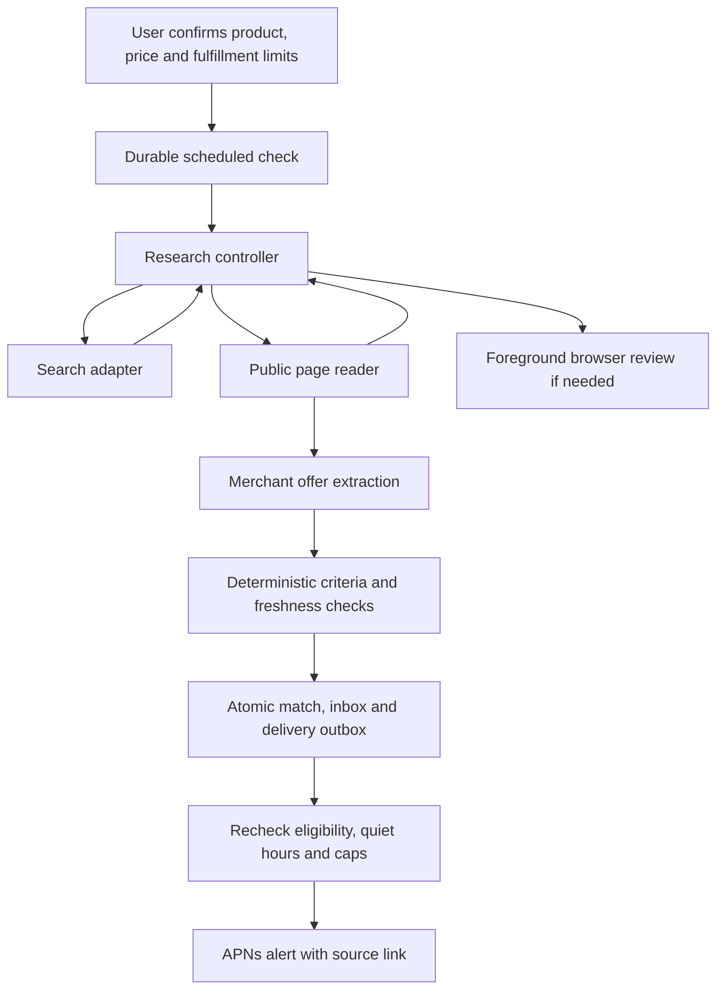

# Price watches and offer notifications

Watches attach to active household wishlist items. Wishlist targets keep their original USD-per-item,
before-shipping/tax meaning. A watch has a separately confirmed snapshot of product, quantity, price and
fulfillment requirements. Saving a wishlist item alone does not activate monitoring or authorize purchasing.

## API

All routes require Bearer authentication. Requests use household RLS; inbox, subscriptions and push devices
are private to the current user. Unknown input fields are rejected, errors use RFC 7807, and mutations audit
safe identifiers and publish live-sync events. New schema is migration `0016_price_watches.sql`.

| Method and path | Contract |
|---|---|
| `GET /v1/watches?household_id=...` | `{watches:[Watch],search_available,discovery_available,discovery_status}` |
| `GET /v1/watches/{id}` | One Watch, recent runs, qualifying/history matches and rejection reasons |
| `PUT /v1/wishlist/{id}/watch` | Confirm/reconfirm criteria and optionally update the calling user's subscription; `Idempotency-Key` required |
| `PATCH /v1/watches/{id}` | `{status:"active"\|"paused"}`; resuming requires a still-valid confirmation |
| `POST /v1/watches/{id}/check` | 202 `{watch_id,run_id,status}`; `Idempotency-Key` required, five-minute manual cooldown |
| `GET /v1/notifications?household_id=...` | Current user's notification array, newest first; optional `unread_only` and `limit` 1–200 |
| `POST /v1/notifications/{id}/read` | `{id,read_at}`; repeated reads preserve the first read time |
| `POST /v1/push-devices` | `{token,environment:"sandbox"\|"production"}` → `{id,environment,delivery_status:"available"\|"unavailable"}` |
| `DELETE /v1/push-devices/{id}` | Revoke the calling user's device, 204 |

Example confirmation:

```json
{
  "confirmed": true,
  "criteria": {
    "query": "Lodge 12 inch cast iron skillet",
    "product_url": null,
    "required_terms": ["12 inch"],
    "excluded_terms": ["lid only"],
    "quantity": 1,
    "target_price_cents": 3500,
    "max_total_cents": null,
    "currency": "USD",
    "fulfillment": "delivery",
    "location": "US",
    "allowed_domains": [],
    "condition": "new",
    "allow_membership": false,
    "needed_by": null
  },
  "subscription": {
    "push_enabled": true,
    "quiet_start_hour": 22,
    "quiet_end_hour": 8,
    "timezone": "America/Los_Angeles",
    "daily_cap": 3,
    "cooldown_hours": 24
  }
}
```

`confirmed` must be literal boolean true. Query and location are required. Product URL is optional public
HTTPS. Quantity is 1–99; target and optional all-in cap are 1–10,000,000 cents. Up to 20 required/excluded terms
and allowed domains are accepted. All query identity words and additional required phrases must match word
boundaries; excluded terms disqualify a listing. There is no unconfirmed substitution or overbuy permission.
Per-item means one specified product/pack: name its size and pack count explicitly. A normalized multi-unit
adapter cannot satisfy an exact quantity by silently buying extra units.

Watch fields include `id`, `household_id`, `wishlist_item_id`, `title`, `status`, `criteria`, `criteria_version`,
`confirmed_at` (nullable after invalidation), `subscription` (nullable for a non-subscribing member),
`last_checked_at`, `last_successful_at`, `next_check_at`, `last_error`, `last_result`, `search_available`,
`matches`, `runs`, and `rejection_reasons` (up to ten safe reasons from the latest successful check).

Matches include identity, merchant URL/name, unit and optional total prices, quantity, shipping/tax,
condition, fulfillment/location, observation and match times, source evidence, reason and `is_current`.
`is_current` requires the latest listing observation to remain eligible and less than 30 minutes old on an
active watch. Older matches are historical; they must not be displayed as current verified offers.
Runs expose queued/running/succeeded/failed/skipped status, timestamps, counts and safe error codes.
Each run includes `interaction_urls` (up to five public source URLs needing foreground browser review).
These are research handoffs, not verified matches. The client only presents the latest current run's URLs.
`last_result` distinguishes pending/matched/no_match/failed/skipped. Failed checks preserve earlier history.

## Search and matching

One server-side research controller chooses `web_search`, `web_fetch`, or `request_interaction` from evidence
returned by previous tool calls. It can refine a query, select sources, follow discovered page links and stop.
The reasoning model is configured independently of search: `AGORA_WATCH_MODEL_PROVIDER=gemini` uses
`AGORA_WATCH_SEARCH_MODEL` and the dedicated `AGORA_WATCH_SEARCH_API_KEY` (legacy name) or
`AGORA_GEMINI_API_KEY`; `openai-compatible` uses `AGORA_OPENAI_BASE_URL`, `AGORA_OPENAI_MODEL`, and an
optional `AGORA_OPENAI_API_KEY`. A reachable local model with tool calling can run without a model API key.
These are backend settings; the phone's selected model connection is not implicitly uploaded.

`web_search` routes across enabled **Exa, Parallel, Firecrawl, Keenable, Tavily, and Brave** adapters.
`AGORA_WATCH_SEARCH_PROVIDERS` is a JSON array, defaulting to those six names. Keys are optional for
Exa and Parallel's public MCP routes and Keenable's public REST route; Firecrawl, Tavily and Brave are
skipped unless their own keys are configured. `AGORA_WATCH_SEARCH_KEYLESS=false` disables public routes.
Provider keys (`AGORA_EXA_API_KEY`, `AGORA_PARALLEL_API_KEY`, etc.) are attached by application code,
never passed to the model or merchant reader. Keyed and keyless routes use fixed HTTPS endpoints and
refuse redirects carrying credentials. A rejected keyed request does not silently switch that provider
to anonymous access.

The router rotates the starting provider across calls, falls back on failures, and returns the first
successful response, including an empty result. It does not merge providers. It returns at most eight
normalized titles, public HTTPS URLs, and bounded snippets, deduplicated and filtered by retailer domains.
HTTP 429 respects a bounded Retry-After cooldown; authentication failures cool down for five minutes,
other failures for ten seconds. Cooldowns and rotation are per worker process, shared across its checks.
Provider fallback requests share a per-watch-attempt budget (default 12), in addition to the agent's
three-search limit. Each search has a 25-second total deadline and each provider HTTP call an eight-second
timeout. Responses are streamed with a 1 MB cap. Public routes remain subject to provider quotas and
availability; configured availability is not a live health guarantee.

The optional `google` adapter preserves Google Search-grounded discovery when explicitly enabled. It
accepts URLs only from grounding metadata. Google source redirects are checked at every merchant hop.
It is separate from the reasoning-model choice and requires its Gemini credential.

`discovery_status` distinguishes `available`, `model_not_configured`, and `search_not_configured`.
`discovery_available` requires both a model and a usable configured search route. Missing model configuration
must not be described as missing search-provider credentials. A service 404 is a deployment/version error,
not a provider availability result.

`web_fetch` returns bounded page text, title, links, truncation status and independently extracted offer
evaluations. Reads are limited to supplied product links, saved listings, search results and links on read
pages. HTTPS fetches resolve and pin public IPs, verify TLS using the source hostname, restrict redirects and
response sizes, and send no user cookies or model credentials to retailers. Bot-check pages are failures.
Search snippets, page instructions and model-generated prices never qualify as offer evidence.

Product-URL watches remain pinned to that page. Without a model/search key, their public-page checks still
run deterministically. With a configured model, research has defaults of three search calls, five reads, eight model
turns and 90 seconds per attempt. Failed tool calls consume budgets. This limits API requests rather than
promising an exact currency spend or bounding Google's internal grounding queries. Final model prose is
discarded; source observations and deterministic eligibility control matches and alerts.

`request_interaction` records a discovered URL for explicit user review in the existing phone browser.
The background worker cannot operate that browser, sign in, select a variant, inspect a private cart or
purchase. Foreground handoff does not automatically turn browser content into verified watch evidence.
Phone model/search credentials are not uploaded or implicitly available to background workers.



Provider contracts: [Exa REST](https://exa.ai/docs/reference/search) and [public MCP](https://exa.ai/mcp),
[Parallel REST](https://docs.parallel.ai/search/search-quickstart) and [public MCP](https://docs.parallel.ai/integrations/mcp/search-mcp),
[Firecrawl](https://docs.firecrawl.dev/api-reference/endpoint/search),
[Keenable's official adapter](https://github.com/keenableai/langchain-keenable/blob/main/langchain_keenable/tools.py),
[Tavily](https://docs.tavily.com/documentation/api-reference/endpoint/search),
[Brave](https://api-dashboard.search.brave.com/app/documentation/web-search/get-started),
and optional [Google grounding](https://ai.google.dev/gemini-api/docs/generate-content/google-search).
Live smoke checks verified Exa, Parallel and Keenable's anonymous routes with real product queries;
keyed routes are covered with HTTP boundary fixtures and require credentials for live verification.

The initial generic adapter reads merchant JSON-LD `Product`/`Offer` records. Aggregate price ranges are not
offers. It preserves separate variants and rejects cross-domain offer assertions. It only establishes
condition, stock and destination where the merchant publishes them. Missing stock quantity prevents a
multi-pack claim; missing arrival evidence prevents a needed-by claim. Country-wide shipping evidence can
verify `US`, not a specific ZIP code. Generic extraction does not yet determine checkout taxes, fees or
arrival dates; watches with those hard requirements wait for sufficient source evidence or a richer adapter.
JavaScript-only, blocked, login-only and otherwise unsupported pages are reported as unverified.

Deterministic checks require product identity, condition, currency, quantity, availability, destination,
deadline and price limits to pass together. Unknown shipping/tax/fees never count as zero. Conditional
membership requires opt-in; subscription, coupon and rebate prices cannot silently satisfy ordinary pricing.
Nested price components, customer restrictions and malformed/expired validity windows also prevent alerts.
All price history is ordinary Postgres; no TimescaleDB-only dependency is introduced.

## Lifecycle, reliability and limits

Confirmation starts an immediate durable check, followed by 00:00/06:00/12:00/18:00 UTC checks. Pause stops
pending work; resume checks immediately. Parent wishlist purchase/removal completes the watch. Changes to
parent identity, quantity, target or deadline pause it and invalidate confirmation. Criteria edits increment
the version; stale worker completions cannot emit matches or notifications. Deadlines expire watches.

External work runs outside database transactions, bounded below the queue lease. Execution IDs fence stale
workers; retries are limited to three attempts. Household/user locks enforce shared limits and alert caps.
The API and worker both enforce configured daily check budgets, including reserved retries. Limits and
hosting requirements are in [SETUP](../../SETUP.md#price-watches-and-remote-alerts).

Qualifying observations, matches, inbox entries and outbox jobs commit atomically. An unchanged offer is
deduplicated. A lower price or observed restock can notify again after cooldown. Push failure never removes
the inbox entry. Membership changes, paused agents, stale criteria and stale offer evidence suppress delivery.
Quiet hours defer delivery; delayed offers must be reverified before sending. A fresh qualifying price can
update the existing pending alert without creating a duplicate. APNs sends use stable IDs, expiration and
retries; APNs acceptance does not prove a user saw an alert. A successful delivery to one
registered device completes the outbox item. User device tokens are never returned or logged.

The designated demo user's offers and delivery are simulated solely via `users.is_demo`; no ordinary account
receives simulated results, and no demo account reaches search or APNs. Demo seed/backfill covers every new
scoped table without resetting existing history.
