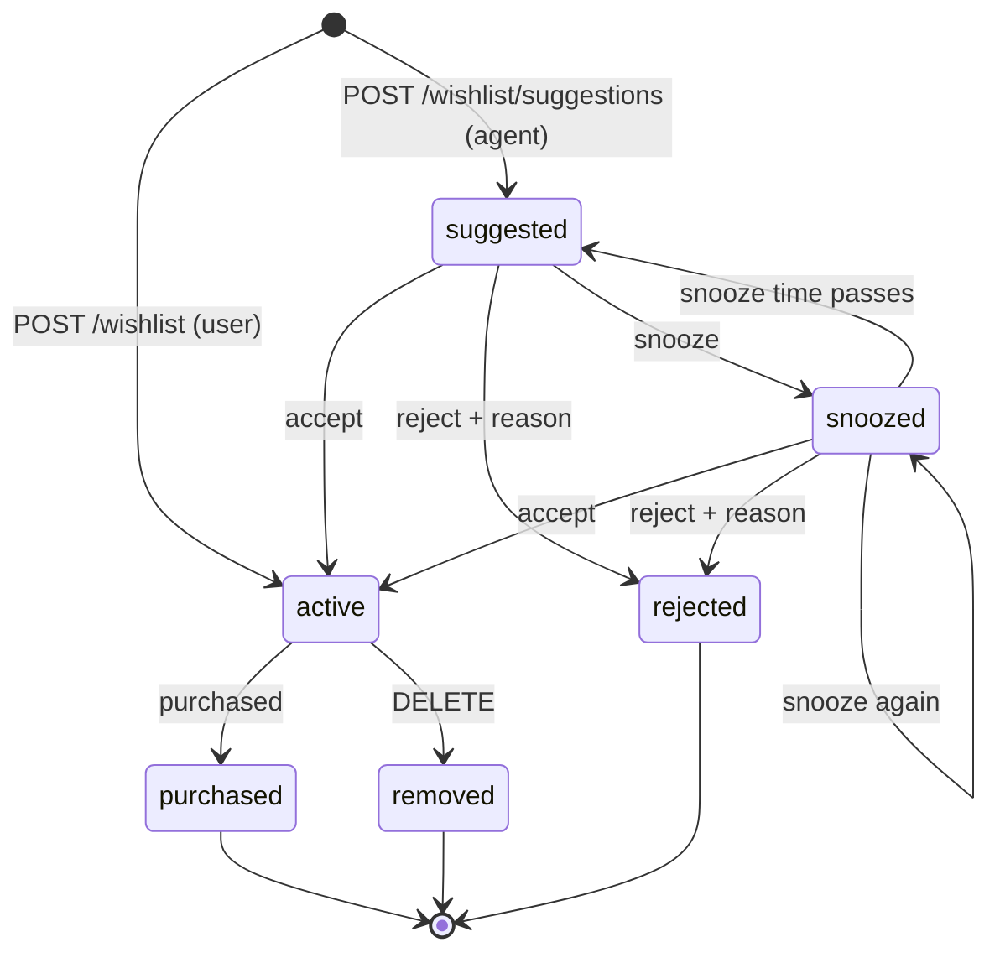

# Wishlist API

A household wishlist that both the user and the on-device agent can add to, ranked as a priority queue.
The iOS Home screen opens Wishlist and Suggested for you. Replenishment suggestions are generated every
six hours by the backend; Find ideas and chat can also submit model-generated suggestions.
Agent suggestions need an explicit decision (accept, reject with a reason, or snooze), and thumbs
feedback teaches the agent without changing an item's status.

All routes are under `/v1/wishlist`, need `Authorization: Bearer <token>`, and return RFC 7807
`application/problem+json` errors. Every change publishes a `wishlist.updated` event on `GET /v1/events`.

Every active item automatically gets a [price watch](price-watches.md). Adding an item or accepting a
suggestion atomically saves the watch and queues its first web price check. Targets are optional: without
one, source prices are displayed without target-price alerts. Default research is for new items with US
delivery; users can refine these preferences in watch settings. Identity, quantity, target and deadline
edits update research and fence stale results. Explicit pauses are preserved; purchasing/removing completes
the watch. Pending suggestions do not start research. Saving never authorizes a purchase or push permission.
If the check budget is exhausted, the item still saves and its watch waits for a later scheduled check.

The examples below were captured from the running app (`kedar` dev account). IDs and timestamps will differ.

## Contents

- [Endpoints](#endpoints)
- [Lifecycle](#lifecycle)
- [Item shape](#item-shape)
- [Adding items](#adding-items)
- [Deciding on suggestions](#deciding-on-suggestions)
- [Thumbs feedback](#thumbs-feedback)
- [Editing, purchasing, removing](#editing-purchasing-removing)
- [Reading the queue](#reading-the-queue)
- [Agent context](#agent-context)
- [How the priority score works](#how-the-priority-score-works)
- [Errors](#errors)
- [Security notes](#security-notes)

## Endpoints

| Route | Who calls it | What it does |
|---|---|---|
| `GET /v1/wishlist?status=active` | app | The wishlist, highest priority first. Repeat `status` for several |
| `GET /v1/wishlist/suggestions` | app | Agent suggestions waiting for a decision, best first. `include_snoozed=true` adds snoozed ones |
| `GET /v1/wishlist/agent-context` | agent | Compact summary of past reactions for the model's prompt |
| `GET /v1/wishlist/refresh-status` | app | Last successful replenishment check, next scheduled check, failure code |
| `POST /v1/wishlist/refresh` | app | Run a replenishment check now; **`Idempotency-Key` required** |
| `GET /v1/wishlist/{id}` | app | One item |
| `POST /v1/wishlist` | app | User adds an item. Goes straight to `active` |
| `POST /v1/wishlist/suggestions` | agent | Agent suggests an item. Starts `suggested`. **`Idempotency-Key` required** |
| `PATCH /v1/wishlist/{id}` | app | Edit title, notes, category, quantity, target price, needed-by, priority, pin |
| `DELETE /v1/wishlist/{id}` | app | Remove an active item (soft: status `removed`) |
| `POST /v1/wishlist/{id}/accept` | app | Accept a suggestion. It joins the active wishlist |
| `POST /v1/wishlist/{id}/reject` | app | Reject a suggestion with a `reason_code` |
| `POST /v1/wishlist/{id}/snooze` | app | "Not now": hide a suggestion until a time |
| `POST /v1/wishlist/{id}/purchased` | app | Mark an active item bought |
| `POST /v1/wishlist/{id}/feedback` | app | Thumbs up/down on any agent suggestion (upsert, one per user) |
| `DELETE /v1/wishlist/{id}/feedback` | app | Withdraw your thumbs |

All list and create routes take an optional `household_id` (query parameter for `GET`, body field for
`POST`). It defaults to the user's first household.

The agent has no separate identity: it calls with the signed-in user's token. The suggestion endpoint
is what marks an item `source: "agent"` and records `actor_type: "agent"` in the audit trail.

## Lifecycle



- **Accept** is a positive signal for the agent.
- **Reject** is a negative signal, unless the reason is `already_have` (that says the timing was off,
  not that the user dislikes it). It also stops the agent re-suggesting the same item for 30 days.
- **Snooze** is neutral. When the time passes the item reads as `suggested` again on the next request; no
  background job is involved.
- `rejected`, `purchased` and `removed` are final. Nothing is hard-deleted.
- PATCH works on `suggested`, `snoozed` and `active` items.
- A disallowed move returns `409 invalid_transition`.

## Item shape

Every endpoint that returns an item returns this shape:

```json
{
  "id": "7f050dc6-d4f6-478a-b783-8ee91b1d34c2",
  "household_id": "a308f99a-2504-4f46-965e-3a9748d2253f",
  "title": "Oat milk",
  "notes": null,
  "category": "dairy",
  "quantity": 2,
  "target_price_cents": 449,
  "needed_by": null,
  "product_id": null,
  "inventory_item_id": null,
  "source": "agent",
  "status": "suggested",
  "pinned": false,
  "priority": null,
  "confidence": 0.86,
  "rationale": "You're down to one carton and usually buy two a week.",
  "evidence": [
    {"kind": "inventory_low", "detail": "1 carton left in the fridge"},
    {"kind": "purchase_history", "detail": "Bought weekly for 6 weeks"}
  ],
  "snoozed_until": null,
  "reject_reason": null,
  "reject_comment": null,
  "my_feedback": null,
  "score": 357.2,
  "priority_reasons": ["Agent is 86% confident"],
  "created_at": "2026-10-17T23:53:47.248818Z",
  "updated_at": "2026-10-17T23:53:47.248818Z",
  "decided_at": null,
  "completed_at": null
}
```

| Field | Notes |
|---|---|
| `source` | `user` or `agent` |
| `status` | `suggested`, `active`, `snoozed`, `rejected`, `purchased`, `removed` |
| `priority` | User's manual priority 1-5 (5 = highest), or `null` for normal |
| `pinned` | Pinned items always sort first |
| `target_price_cents` | USD cents per item, before shipping/tax; a user target, not a current offer |
| `category` | Stored lowercased, so "Snacks" and "snacks" learn together |
| `confidence`, `rationale`, `evidence` | Set on agent suggestions only |
| `snoozed_until` | Set only while a snooze is in effect |
| `my_feedback` | The calling user's thumbs on this item: `up`, `down` or `null` |
| `score`, `priority_reasons` | Server-computed rank and up to four short reasons. See [scoring](#how-the-priority-score-works) |
| `decided_at` | When it was accepted, rejected or snoozed |
| `completed_at` | When it was purchased or removed |

## Adding items

### User: `POST /v1/wishlist` → 201

```http
POST /v1/wishlist
Content-Type: application/json

{
  "title": "Birthday candles",
  "notes": "Blue, for Saturday",
  "category": "party",
  "needed_by": "2026-10-19",
  "target_price_cents": 499
}
```

```json
{
  "id": "71a5a62a-d6f5-46cf-8fa5-5acb624be8a2",
  "title": "Birthday candles",
  "source": "user",
  "status": "active",
  "score": 385.0,
  "priority_reasons": ["Needed in 2 days", "Added by you"],
  "...": "remaining item fields"
}
```

| Field | Rules |
|---|---|
| `title` | Required, 1-120 characters |
| `notes` | Up to 1000 characters |
| `category` | 1-40 characters. Borrowed from the linked inventory item or product if omitted |
| `quantity` | 1-99, default 1 |
| `target_price_cents` | 0-10,000,000 |
| `needed_by` | `YYYY-MM-DD` |
| `priority` | 1-5 |
| `pinned` | Boolean, default `false` |
| `inventory_item_id` | Must be in the same household. Lets the score see when stock is below par |
| `product_id` | A catalog product |

Unknown fields are rejected with 422. Adding something already open (suggested, snoozed or active, matched on
the normalized title) returns `409 already_on_wishlist`.

Linking an inventory item that is below its par level raises the item's score and explains why:

```json
{"title": "Paper towels", "inventory_item_id": "de0ec513-…", "category": "household", "score": 380.0,
 "priority_reasons": ["Added by you", "Running low: 1 left, you keep 4"]}
```

### Agent: `POST /v1/wishlist/suggestions` → 201

```http
POST /v1/wishlist/suggestions
Content-Type: application/json
Idempotency-Key: sugg-oatmilk-20261017

{
  "title": "Oat milk",
  "rationale": "You're down to one carton and usually buy two a week.",
  "confidence": 0.86,
  "category": "dairy",
  "quantity": 2,
  "target_price_cents": 449,
  "evidence": [
    {"kind": "inventory_low", "detail": "1 carton left in the fridge"},
    {"kind": "purchase_history", "detail": "Bought weekly for 6 weeks"}
  ]
}
```

The response is the item shown in [Item shape](#item-shape).

| Field | Rules |
|---|---|
| `title` | Required, 1-120 characters |
| `rationale` | **Required**, 1-500 characters. Shown to the user on the suggestion card |
| `confidence` | **Required**, 0-1 |
| `evidence` | Up to 5 of `{kind, detail}`. `kind` is one of `inventory_low`, `purchase_history`, `calendar`, `price`, `seasonal`, `other`. `detail` is 1-200 characters |
| `category`, `quantity`, `target_price_cents`, `needed_by`, `product_id`, `inventory_item_id` | As for the user endpoint |

Behaviour:

- **Idempotent.** Retrying with the same key and body returns the original response with an
  `Idempotent-Replay: true` header. Reusing a key with a different body returns `422 idempotency_key_reused`.
  A missing or malformed key returns `400 idempotency_key_required`.
- **Re-suggestion guard.** If the user rejected the same item (same normalized title, so "potato chip"
  matches "Potato chips") in the last 30 days, the request is refused and the attempt is recorded in the
  audit log as `wishlist.suggestion_blocked`. The one exception: a `too_expensive` rejection can be
  re-suggested with a strictly lower `target_price_cents` than the rejected one.

  ```json
  {
    "type": "https://agora.app/problems/recently_rejected",
    "title": "recently_rejected",
    "status": 409,
    "detail": "This was rejected in the last 30 days. Check /v1/wishlist/agent-context before suggesting.",
    "request_id": "969ddbec108a400fa12c14e29c43dd51"
  }
  ```

- Suggesting something already open returns `409 already_on_wishlist`.
- At most 50 suggestions can wait for a decision at once. More returns `409 too_many_suggestions`.
- The user can always add a rejected item themselves with `POST /v1/wishlist`.

## Deciding on suggestions

All three work on `suggested` and `snoozed` items and return the updated item.

### Accept: `POST /v1/wishlist/{id}/accept`

No body. The status becomes `active`.

### Reject: `POST /v1/wishlist/{id}/reject`

```json
{"reason_code": "not_interested", "comment": "Trying to cut back"}
```

`reason_code` is required and is one of `not_interested`, `already_have`, `too_expensive`, `wrong_item`,
`other`. `comment` is optional, up to 500 characters.

```json
{"id": "1b8d876e-…", "title": "Potato chips", "status": "rejected", "reject_reason": "not_interested",
 "reject_comment": "Trying to cut back", "decided_at": "2026-10-17T23:53:47.630036Z", "...": "…"}
```

### Snooze ("Not now"): `POST /v1/wishlist/{id}/snooze`

Send exactly one of these:

```json
{"days": 14}
```

```json
{"until": "2026-10-31T09:00:00-07:00"}
```

`days` is 1-180. `until` must include a UTC offset and be in the next 180 days.

```json
{"id": "2a38f424-…", "title": "Sunscreen", "status": "snoozed",
 "snoozed_until": "2026-10-31T23:53:47.759696Z", "...": "…"}
```

## Thumbs feedback

### `POST /v1/wishlist/{id}/feedback` → 200

```json
{"rating": "down", "reason_code": "not_interested"}
```

```json
{
  "wishlist_item_id": "1b8d876e-1440-4c04-a9d6-0bb94cde8fbd",
  "rating": "down",
  "reason_code": "not_interested",
  "comment": null,
  "updated_at": "2026-10-17T23:53:47.790444Z"
}
```

- `rating` is `up` or `down`. `reason_code` is optional and uses the reject codes. `comment` is up to
  500 characters.
- Each user has one rating per item. Sending again replaces it.
- It works on any agent suggestion, whatever its status, including rejected and purchased ones. On
  user-added items it returns `409 not_a_suggestion`.
- It never changes the item's status. The item's `my_feedback` shows the caller's current rating.
- `DELETE /v1/wishlist/{id}/feedback` withdraws your rating and returns 204.
- Household members see each other's ratings in the ranking, but can only write their own. This is
  enforced by row-level security.

## Editing, purchasing, removing

### `PATCH /v1/wishlist/{id}`

Send only the fields to change: `title`, `notes`, `category`, `quantity`, `target_price_cents`,
`needed_by`, `priority`, `pinned`. Sending `null` clears `notes`, `category`, `target_price_cents`,
`needed_by` and `priority`. `title`, `quantity` and `pinned` cannot be null.

```json
{"quantity": 3, "priority": 4}
```

```json
{"id": "7f050dc6-…", "title": "Oat milk", "quantity": 3, "priority": 4, "score": 457.2,
 "priority_reasons": ["You set priority high", "Agent is 86% confident"], "...": "…"}
```

### `POST /v1/wishlist/{id}/purchased`

No body. Works on `active` items only.

### `DELETE /v1/wishlist/{id}`

Works on `active` items only and returns the item with status `removed`. Suggestions must be rejected or
snoozed instead:

```json
{
  "type": "https://agora.app/problems/invalid_transition",
  "title": "invalid_transition",
  "status": 409,
  "detail": "Can't remove an item that is snoozed. Reject or snooze a suggestion instead.",
  "request_id": "055a6291e8344b2296294ce0988c053c"
}
```

## Reading the queue

### `GET /v1/wishlist`

Query parameters:

| Parameter | Default | Notes |
|---|---|---|
| `status` | `active` | Repeatable, e.g. `?status=purchased&status=removed` for history |
| `household_id` | first household | |
| `limit` | 100 | 1-200 |

Items come back sorted by `score`, highest first. Ties go to the older item first, then by id, so the
order is stable between requests. Captured response, trimmed to the ranking fields:

```json
[
  {"title": "AA batteries", "source": "user", "pinned": true, "priority": null, "score": 1365.0,
   "priority_reasons": ["Pinned by you", "Added by you"]},
  {"title": "Oat milk", "source": "agent", "pinned": false, "priority": 4, "my_feedback": "up", "score": 457.2,
   "priority_reasons": ["You set priority high", "Agent is 86% confident"]},
  {"title": "Birthday candles", "source": "user", "pinned": false, "priority": null, "score": 385.0,
   "priority_reasons": ["Needed in 2 days", "Added by you"]},
  {"title": "Paper towels", "source": "user", "pinned": false, "priority": null, "score": 380.0,
   "priority_reasons": ["Added by you", "Running low: 1 left, you keep 4"]}
]
```

### `GET /v1/wishlist/suggestions`

Returns pending suggestions in the same shape and order. Expired snoozes appear here again automatically.
Pass `include_snoozed=true` to include snoozed ones too.

## Agent context

### `GET /v1/wishlist/agent-context`

The on-device model reads this before suggesting anything. It is small enough to paste into a prompt as is,
or the model can use only `summary`.

```json
{
  "household_id": "a308f99a-2504-4f46-965e-3a9748d2253f",
  "generated_at": "2026-10-17T23:53:48.188154+00:00",
  "window_days": 30,
  "suggestions": {"accepted": 1, "rejected": 2, "pending": 2, "acceptance_rate": 0.33},
  "liked_categories": [{"category": "dairy", "count": 2}],
  "disliked_categories": [{"category": "snacks", "count": 2}, {"category": "kitchen", "count": 1}],
  "recently_rejected": [
    {"title": "Blender", "category": "kitchen", "reason_code": "too_expensive", "comment": null,
     "rejected_at": "2026-10-17T23:53:47.703433+00:00"},
    {"title": "Potato chips", "category": "snacks", "reason_code": "not_interested",
     "comment": "Trying to cut back", "rejected_at": "2026-10-17T23:53:47.630036+00:00"}
  ],
  "do_not_suggest": [
    {"title": "Blender", "reason": "rejected:too_expensive", "until": "2026-11-16",
     "unless_price_below_cents": 9900},
    {"title": "Potato chips", "reason": "rejected:not_interested", "until": "2026-11-16"},
    {"title": "Birthday candles", "reason": "already_on_wishlist"},
    {"title": "AA batteries", "reason": "already_on_wishlist"},
    {"title": "Paper towels", "reason": "already_on_wishlist"},
    {"title": "Oat milk", "reason": "already_on_wishlist"},
    {"title": "Sunscreen", "reason": "already_snoozed"},
    {"title": "Pretzels", "reason": "already_suggested"}
  ],
  "summary": "Accepted 1 of 3 decided suggestions. Likes: dairy (2). Avoid: snacks (2), kitchen (1). Do not suggest: Blender, Potato chips, Birthday candles, AA batteries, Paper towels, Oat milk, Sunscreen, Pretzels."
}
```

| Field | Meaning |
|---|---|
| `suggestions.acceptance_rate` | accepted / (accepted + rejected), all time. `null` before any decision |
| `liked_categories` | Accepted suggestions plus thumbs-up, per category |
| `disliked_categories` | Thumbs-down plus rejections (except `already_have`), per category |
| `recently_rejected` | Rejections in the last 30 days, newest first, with the user's comment truncated to 140 characters |
| `do_not_suggest` | What the suggestion endpoint will refuse right now, plus everything already open |

Titles and comments here are the household's own data, returned to its own device. The model should treat
them as data, not instructions.

## How the priority score works

The scoring logic is a pure function in `backend/app/core/wishlist.py`, unit-tested in
`tests/test_wishlist_core.py`. The score has three layers, so the user's own choices always win:

```
score = 1000 if pinned
      + 100 × priority tier (the user's 1-5; unset counts as 3)
      + signal points, clamped to 0-99
```

A pinned item beats every unpinned one. A priority-4 item beats every priority-3 item, however strong the
signals. Within a tier, signal points start at 50 and add up:

| Signal | Points | Reason shown |
|---|---|---|
| Added by the user | +15 | "Added by you" |
| Agent confidence *c* | (c − 0.5) × 20, so −10 to +10 | "Agent is 86% confident" |
| Feedback on same-category suggestions (agent items only) | net × 4, from −16 to +12 | "You turned down 2 similar suggestions in snacks" / "You liked 2 similar suggestions in dairy" |
| Feedback on same-title suggestions (agent items only) | net × 8, from −24 to +16 | "You turned this down before" / "You liked this suggestion before" |
| `needed_by` overdue / ≤3 days / ≤7 / ≤14 | +25 / +20 / +12 / +6 | "Needed in 2 days", "Past its needed-by date" |
| Linked inventory below its par level | +15 | "Running low: 1 left, you keep 4" |
| Age, from 3 days on | +days ÷ 3, max +10 | "Waiting 9 days" |

Feedback rules:

- "Liked" counts accepts and thumbs-up. "Disliked" counts thumbs-down and rejections, except
  `already_have`. Snoozes count for neither.
- An item's own feedback never counts toward its own score.
- Feedback only adjusts agent suggestions. It never re-ranks something the user added themselves.

That is how negative feedback down-weights new suggestions. In the capture above, two snack items had been
turned down, so a new "Pretzels" suggestion at 62% confidence scored 344.4 with the reason "You turned down 2
similar suggestions in snacks". A neutral suggestion at the same confidence scores 352.4.

`priority_reasons` lists pin and priority first, then the remaining signals by the size of their effect, at
most four. Signals worth zero points are left out.

## Errors

| Status | `title` | When |
|---|---|---|
| 400 | `idempotency_key_required` | Suggestion without a valid `Idempotency-Key` (8-128 printable ASCII) |
| 404 | `not_found` | Item, household, inventory item or product doesn't exist or isn't yours |
| 409 | `invalid_transition` | e.g. accepting a purchased item or removing a suggestion |
| 409 | `already_on_wishlist` | Same normalized title is already suggested, snoozed or active |
| 409 | `recently_rejected` | Agent re-suggested something rejected in the last 30 days |
| 409 | `too_many_suggestions` | 50 suggestions already waiting |
| 409 | `not_a_suggestion` | Thumbs feedback on a user-added item |
| 409 | `duplicate_request` | Concurrent requests with the same idempotency key |
| 422 | `invalid_request` | Schema validation failed, unknown field, or a null for a required field |
| 422 | `invalid_snooze` | `until` without an offset, in the past, or more than 180 days away |
| 422 | `idempotency_key_reused` | Same key, different body |

## Security notes

- `wishlist_items` and `wishlist_feedback` have row-level security limited to the caller's households. A
  composite foreign key keeps feedback in its item's household. Feedback rows can only be written by
  their author.
- The request role has no `DELETE` on `wishlist_items`. Removal is a status change, so history stays.
- Audit entries record only actions, enums and counts: no titles, notes, rationales or comments. The actions
  are `wishlist.item_added`, `wishlist.suggested` (actor `agent`), `wishlist.suggestion_blocked` (actor
  `agent`), `wishlist.accepted`, `wishlist.rejected`, `wishlist.snoozed`, `wishlist.purchased`,
  `wishlist.removed`, `wishlist.item_updated` (field names only), `wishlist.feedback` and
  `wishlist.feedback_cleared`.
- SSE events carry only `{household_id, type: "wishlist.updated", id}`. Clients refetch through the API.


## Scheduled replenishment and refresh status

`GET /v1/wishlist/refresh-status?household_id=...` returns:

```json
{
  "household_id": "a308f99a-2504-4f46-965e-3a9748d2253f",
  "last_refreshed_at": "2026-10-18T06:00:01Z",
  "next_refresh_at": "2026-10-18T12:00:00Z",
  "last_error": null,
  "generated_count": 2
}
```

`last_refreshed_at` is null before the first successful check; `generated_count` is the count from the last
successful check. Failure records `last_error: "refresh_failed"` without clearing the previous successful
check or suggestions. Status and all reads remain household-scoped.

`POST /v1/wishlist/refresh` accepts `{}` or `{"household_id": "..."}` and returns the same shape, HTTP 200.
An `Idempotency-Key` is required; replay returns the original result without generating again. A paused
agent receives `409 agent_paused` for refresh and suggestion submission. Manual refresh does not shift the six-hour UTC schedule.

The worker checks at 00:00, 06:00, 12:00 and 18:00 UTC. It uses stock observations from the last 30 days and
forecasts anchored to the latest observation. It proposes at most five items per run, skips unknown stock,
open wishlist entries (including snoozes), recent rejections, purchases/removals from the last seven days,
and unchecked items on open shopping lists. It preserves user targets and decisions. Suggested quantities
start at one; the user can edit them. No external model or merchant requests occur in scheduled checks.
A worker must be available to execute on time; after downtime, one current check replaces missed intervals.

Model-backed Find ideas is an on-device action using the selected Suggestions model, followed by the
existing suggestion POST. Model output cannot set target prices through that UI flow. The chat tools
`shopping_context` and `shopping_suggest` share this persistence path. All suggestions still require user
acceptance to join the active wishlist. Live retailer prices and automatic purchase execution are outside
this feature.
