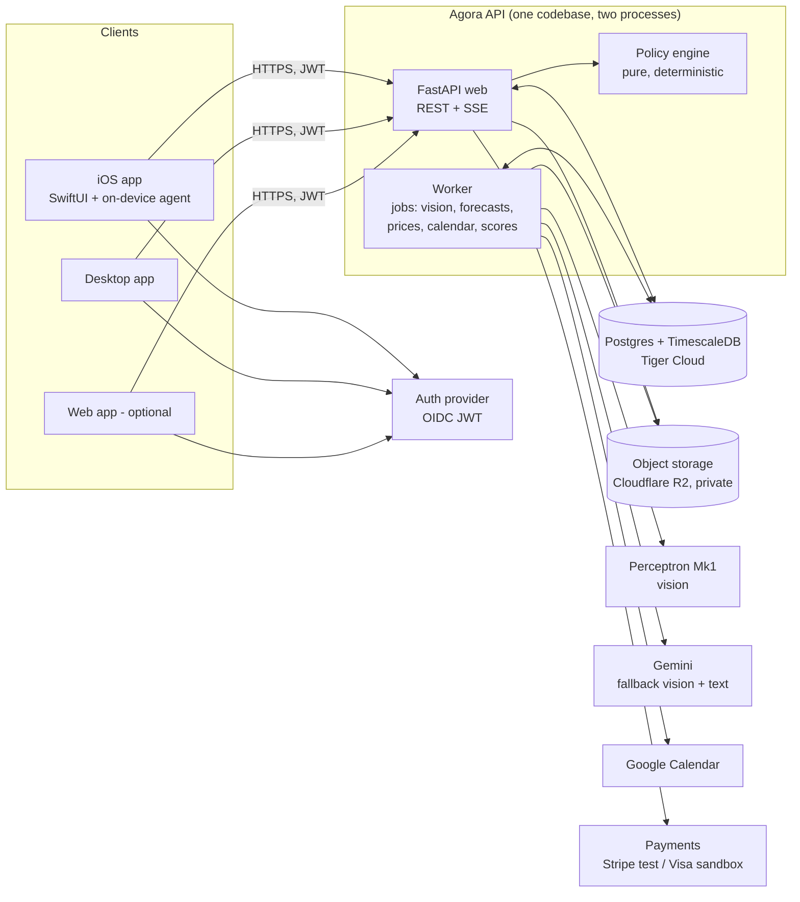
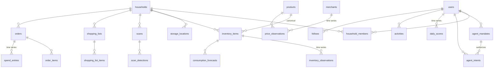
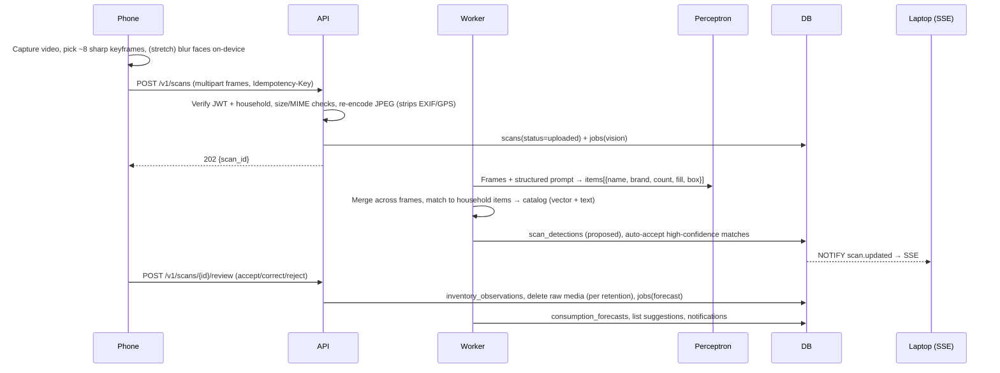

# Agora Backend & Data Spec (v0.1)

Status: draft for team review · Scope: API, database, background jobs, storage, security model · Out of scope: client UI

## 1. What we're building, in one paragraph

Agora is a household commerce copilot. You point your phone at your fridge or pantry; Agora works out what you have, learns how fast you use it, predicts when you'll run out, and then *acts*: it builds per-store shopping lists, watches prices, books a grocery run in your calendar, suggests local small businesses, and (within limits you set) buys things for you. Spending, budgets, and a health/waste score come for free from the same data, and you can share the score (never the photos) with friends, Strava-style.

The backend's job is to be the **system of record and the trust boundary**. The LLM proposes; deterministic, auditable backend code decides what is allowed to happen.

### Rubric mapping (why each piece exists)

| Rubric (weight) | What the backend contributes | Demo moment |
|---|---|---|
| Innovation (25%) | Vision-driven inventory → consumption-rate forecasting → proactive commerce; "fridge Strava" | Scan fridge on phone; desktop shows "Milk runs out Thu ±1d" live |
| Tech execution (20%) | Time-series DB, vision pipeline with provenance, policy engine, OpenAPI-typed clients | Chart of quantity over time with forecast band; detection boxes over the frame |
| UX (20%) | Fast APIs, cross-device sync (SSE), human review of AI guesses, demo replay mode that never fails | Phone scan → desktop updates in <2s |
| Commerce impact (15%) | Run-out-driven lists, price-drop alerts, small-business routing, agent checkout within mandates | "Agent bought eggs from the local co-op for $4.20, within your $25/week grocery mandate" |
| Trust & responsibility (15%) | Mandates + autonomy levels, hash-chained audit log, data minimization enforced by the DB, no card data, privacy center | Kill switch; "verify audit chain"; "export/delete my data"; raw photos auto-deleted |

---

## 2. Architecture



**Key decisions**

1. **One API, many clients.** iOS, desktop, and any web app all use the same versioned REST API (`/v1`). The OpenAPI 3.1 spec is generated from the server and committed; Swift clients are generated with `swift-openapi-generator`, TS with `openapi-typescript`. Cloud accounts mean "scan on phone, review on laptop" works out of the box.
2. **One database does everything.** Postgres is the system of record, the job queue (`FOR UPDATE SKIP LOCKED`), the pub/sub for live sync (`LISTEN/NOTIFY` → SSE), the time-series store (TimescaleDB), and the vector index (pgvector/pgvectorscale). No Redis, no Kafka, no separate vector DB. Fewer moving parts means fewer demo failures.
3. **The browser agent stays on-device, side effects go through the backend.** The existing iOS app drives a WKWebView with Gemini and per-action approvals. That stays. What changes is that any agent action with real-world effect (purchase, add to cart, calendar event) is first registered as an **intent** with the backend, which runs the policy engine and records the outcome. Background agents (forecasting, price watch, trip planning) run in the worker.
4. **"LLM proposes, policy disposes."** Models never hold payment credentials or call payment APIs directly. The policy engine is ordinary, unit-tested code.

### Stack

| Layer | Choice | Why |
|---|---|---|
| Language/framework | Python 3.12, FastAPI, Pydantic v2, asyncpg | Fastest path to typed APIs + auto OpenAPI; Python is best for vision/forecasting code |
| DB | Postgres 17 + TimescaleDB (Tiger Cloud; local: `timescale/timescaledb-ha` Docker image) | Time-series is the core of the product (see §5) |
| Migrations | Alembic with raw SQL ops | Timescale DDL is SQL anyway; keeps it explicit |
| Object storage | Cloudflare R2 (S3 API), private bucket | Free tier, no egress fees, S3-compatible so swappable |
| Auth | Pluggable verifier: `dev` (HMAC JWT for seeded demo users) and `oidc` (JWKS). Recommended IdP: Supabase Auth *used only for auth* (Sign in with Apple/Google, Swift + JS SDKs) | Auth never blocks backend work; real sign-in can be added later |
| Hosting | Fly.io (`sea` region), one app with `web` + `worker` process groups, min 1 machine always on | Cheap, Docker-native, no cold starts during judging. Railway/Render are drop-in alternatives |
| Vision | Perceptron Mk1 (primary), Gemini (fallback) behind a `VisionProvider` interface | Sponsor fit + resilience |
| Tests/CI | pytest + testcontainers (Timescale image), ruff, GitHub Actions | Real DB in tests; migrations tested every push |

Repo layout (monorepo, existing iOS app untouched):

```
backend/
  app/            api routers, schemas, deps (auth, db, household scope)
  core/           policy engine, forecasting, matching (pure, no I/O)
  providers/      vision (perceptron, gemini, replay), payments, calendar, storage
  worker/         job runner + job handlers
  migrations/     alembic; timescale-specific steps clearly separated
  seed/           demo households, catalog subset, price history, replay fixtures
  tests/
api/openapi.json  generated, committed, diffed in CI
docs/backend-spec.md
```

---

## 3. Data we manage

Everything personal is scoped to a **household** (a fridge is shared). Every user gets a personal household automatically, so we pay nothing for this now and avoid a painful migration later.

Data falls into five sensitivity tiers, and the tier decides how it is stored:

| Tier | Examples | Handling |
|---|---|---|
| **S0 Public/global** | Product catalog, merchant info, public price observations | No user linkage; freely cached |
| **S1 Personal** | Inventory, shopping lists, goals, scores | Household-scoped, RLS, exportable/deletable |
| **S2 Sensitive** | Orders, spend, budgets, calendar-derived free/busy, coarse location | As S1, plus never in logs, never shared socially, short API cache |
| **S3 Secret** | OAuth refresh tokens, push tokens | App-level AES-256-GCM envelope encryption (`key_id` stored for rotation) |
| **S4 Raw media** | Fridge photos/video frames, receipt photos | EXIF stripped on ingest, private bucket, short-lived signed URLs, **deleted after review or 24h TTL** by default |
| **Never stored** | Card numbers, CVV, passwords, bank credentials | Only provider tokens + brand/last4. PCI scope stays with Stripe/Visa |

### 3.1 Entity overview



### 3.2 Tables by domain

Conventions: `uuid` PKs (v7, time-ordered), `timestamptz` everywhere, money as `bigint` cents + `char(3)` currency, soft enums as `text` + `CHECK`. Tables marked **HT** are hypertables (see §5).

**Identity, privacy, devices**

| Table | Key columns | Notes |
|---|---|---|
| `users` | `id, auth_subject (unique), handle (unique), display_name, created_at, deleted_at` | No email stored unless needed; IdP owns it |
| `user_settings` | `user_id, timezone, autonomy_level, household_size, home_geohash5, media_retention ('delete_after_review'\|'24h'\|'7d'), share_defaults` | `home_geohash5` ≈ 5km cell, never exact address |
| `households`, `household_members` | `household_id, user_id, role ('owner'\|'member')` | Authorization unit |
| `consents` | `user_id, scope, granted_at, revoked_at, policy_version` | Append-only. Scopes: `vision`, `calendar`, `payments`, `social`, `location` |
| `devices` | `id, user_id, platform, name, push_token_enc, last_seen_at` | For "your devices" list + revoke |
| `integrations` | `user_id, provider ('google_calendar'), scopes[], refresh_token_enc, status` | S3 encryption, least-privilege scopes |

**Catalog & merchants (global, S0)**

| Table | Key columns | Notes |
|---|---|---|
| `products` | `id, name, brand, category, subcategory, unit, size_value, size_unit, gtin, nutrition jsonb, image_url, embedding vector(768), search_tsv` | Seeded from an Open Food Facts subset; new products created from detections |
| `merchants` | `id, name, kind ('grocery'\|'big_box'\|'online'\|'local'), is_small_business, website, lat, lng, hours jsonb` | Small businesses flagged for routing |
| `merchant_offers` | `merchant_id, product_id, url, sku, last_seen_at` | Where a product can be bought |

**Inventory ("fridge Strava")**

| Table | Key columns | Notes |
|---|---|---|
| `storage_locations` | `id, household_id, name, kind ('fridge'\|'freezer'\|'pantry'\|'bathroom'\|'other')` | |
| `inventory_items` | `id, household_id, product_id?, custom_name, location_id, unit, par_level, preferred_merchant_id?, tracking ('scan'\|'purchase'\|'manual'), status` | The thing being tracked; product link optional |
| `scans` | `id, household_id, user_id, location_id, captured_at, media_kind, media_keys[], media_deleted_at, status, provider, model, model_version, latency_ms, error_code` | Status: `uploaded → processing → needs_review → confirmed` (or `failed`) |
| `scan_detections` | `id, scan_id, label_raw, product_id?, inventory_item_id?, match_score, confidence, quantity, quantity_unit, fill_fraction, bbox jsonb, frame_index, review ('proposed'\|'accepted'\|'corrected'\|'rejected')` | **Provenance**: every inventory fact traces to a frame + model + confidence |
| `inventory_observations` **HT** | `time, household_id, inventory_item_id, quantity, source ('scan'\|'manual'\|'purchase'\|'receipt'\|'inferred_restock'), scan_id?, confidence` | The core time series |
| `consumption_forecasts` **HT** | `time (computed_at), inventory_item_id, household_id, rate_per_day, rate_lo, rate_hi, qty_now, runout_at, runout_lo, runout_hi, n_obs, method` | Keeping history lets us show "forecast vs actual" |

**Commerce, spend, budgets**

| Table | Key columns | Notes |
|---|---|---|
| `shopping_lists`, `shopping_list_items` | `list: household_id, merchant_id?, status` · `item: product_id?/inventory_item_id?, qty, reason ('runout'\|'manual'\|'agent'\|'price_drop'), added_by ('user'\|'agent'), explanation` | Agent-added items always carry an explanation |
| `watchlist` | `user_id, product_id, merchant_id?, target_price_cents` | Price-drop alerts |
| `price_observations` **HT** | `time, product_id, merchant_id, price_cents, unit_price_cents, currency, in_stock, source` | Global, no PII |
| `orders`, `order_items` | `order: household_id, user_id, merchant_id, placed_at, channel ('online'\|'in_store'\|'agent'), status, totals, payment_ref, payment_brand, payment_last4, agent_intent_id?` · `item: product_id?, inventory_item_id?, qty, unit_price_cents, category` | Created from receipts, agent checkouts, or manual entry |
| `receipts` | `id, order_id?, media_key, parsed jsonb, status` | Receipt photo → order + prices + restock (big quick win) |
| `spend_entries` **HT** | `time, household_id, user_id, amount_cents, currency, category, merchant_id, order_id` | Feeds budget dashboards via continuous aggregates |
| `budgets` | `household_id, period ('week'\|'month'), category?, limit_cents, starts_on` | |
| `payment_methods` | `user_id, provider, provider_token_ref, brand, last4, exp_month, exp_year` | Tokens only |

**Agent & trust**

| Table | Key columns | Notes |
|---|---|---|
| `agent_mandates` | `id, user_id, household_id, merchant_ids[]?, categories[]?, max_per_txn_cents, max_per_period_cents, period, require_confirm_above_cents, expires_at, status, revoked_at` | User-granted spending authority. Mirrors the "spending limits and controls" model of Visa Intelligent Commerce agent credentials |
| `agent_intents` | `id, user_id, household_id, kind ('purchase'\|'add_to_cart'\|'list_add'\|'calendar_event'\|'price_watch'), payload jsonb, amount_cents?, merchant_id?, rationale, evidence jsonb, decision ('allow'\|'needs_approval'\|'deny'), decision_reasons[], mandate_id?, status, idempotency_key (unique), created_at, decided_at, decided_by` | Status: `proposed → approved/rejected → executing → succeeded/failed/outcome_unknown` (matches the iOS app's existing journal semantics) |
| `audit_log` | `id bigserial, time, actor_type, actor_id, household_id, action, target_type, target_id, meta jsonb, prev_hash, hash` | Append-only, hash-chained, app role has no `UPDATE/DELETE`. No PII in `meta` |

**Calendar & trips**

| Table | Key columns | Notes |
|---|---|---|
| `shopping_trips` | `id, household_id, merchant_id, list_id, window_start, window_end, external_event_id?, status ('proposed'\|'scheduled'\|'done'\|'cancelled'), rationale` | Uses Google free/busy; only the event ID is stored, not the user's calendar |

**Social / scores**

| Table | Key columns | Notes |
|---|---|---|
| `goals` | `user_id, kind ('high_protein'\|'low_sugar'\|'vegetarian'\|'budget'\|'low_waste'…), params jsonb` | |
| `daily_scores` **HT** | `time (day), user_id, health, budget, waste, scan_streak, components jsonb` | Derived only; the only thing that can be shared |
| `follows` | `follower_id, followee_id, status ('pending'\|'accepted')` | Approval required |
| `activities` | `id, user_id, kind ('score'\|'streak'\|'achievement'\|'swap'), payload jsonb, visibility ('private'\|'followers'), created_at` | Built from a server-generated preview the user confirms. Never contains photos, items, or spend unless the user explicitly adds them |
| `kudos` | `activity_id, user_id, created_at` | |

**Infrastructure**

| Table | Purpose |
|---|---|
| `jobs` | Postgres job queue: `kind, payload, run_at, attempts, max_attempts, locked_until, status, last_error`. Claimed with `SKIP LOCKED`; exponential backoff |
| `idempotency_keys` | `user_id, key, request_hash, response, created_at` for every mutating POST (mobile retries over bad wifi) |
| `notifications` | Price drops, run-outs, approvals waiting |

---

## 4. Core flows

### 4.1 Scan → inventory (the hero flow)



- **Desktop** can upload a video instead; the worker extracts keyframes with ffmpeg. Same pipeline.
- **Matching**: first against the household's own items (most scans are of things we've seen before), then the catalog with hybrid search (vector similarity on the label embedding + full-text on name/brand). Unmatched items become new `inventory_items` after review.
- **Human in the loop**: low-confidence or new items always go to review with boxes drawn over the frame. Corrections are stored, so we can show accuracy improving over the demo.
- **Reliability**: provider timeout → retry → fall back to Gemini → if both fail, scan is `failed` with a clear error and the frames are kept for retry. **Replay mode**: model outputs are cached by frame hash, and demo fixtures ship with cached results, so the live demo works on bad venue wifi.

### 4.2 Consumption rate & run-out forecasting

Inputs per item: irregular `(time, quantity)` observations from scans and manual edits, plus purchases from receipts/orders.

1. **Regularize**: `time_bucket_gapfill('1 day') + locf()` gives a daily series from irregular scans (one SQL query on Timescale).
2. **Segment at restocks**: a quantity jump above a threshold, or a matching purchase, starts a new depletion segment. A jump with *no* recorded purchase creates an `inferred_restock` observation and a prompt: "Looks like you bought eggs. Add $4.29 to spending?"
3. **Rate**: robust slope (Theil–Sen) per segment, recency-weighted across segments. Cold start blends in a category prior scaled by household size: `r = (k·r_prior + n·r_obs)/(k + n)`.
4. **Run-out**: `runout_at = now + qty_now / r`, with an interval from the spread of segment slopes.
5. **Purchase-only items** (things you don't scan, like toothpaste): use the inter-purchase interval from orders.
6. **Explainability**: every forecast carries the evidence. "Milk runs out Thu (Wed–Fri). Based on 9 scans over 12 days, you use about 0.3 gal/day."

The math lives in `core/forecast.py` as pure functions with unit tests. Recomputed on every confirmed scan and nightly.

### 4.3 From forecast to action (agentic commerce)

Autonomy levels (from the planning doc), set per user and narrowed per mandate:

| Level | Agent may | Backend behaviour |
|---|---|---|
| L0 Inform | Suggest | Intents are never executed |
| L1 Prepare | Add to lists/carts, draft trips | `list_add`/`add_to_cart` allowed; purchases need approval |
| L2 Buy with approval | Prepare checkout | Every purchase → `needs_approval` with rationale + evidence |
| L3 Buy within mandate | Purchase autonomously | Allowed only if **all** checks pass; anything else escalates to L2 |

`decide(intent, settings, mandates, budgets, recent_intents) → (decision, reasons[])` checks: consent, autonomy level, mandate scope (merchant, category), per-transaction cap, period cap, remaining budget, velocity (e.g. ≤3 purchases/hour), duplicate detection (same item already ordered or in transit), and mandate expiry. It is a pure function with a table-driven test suite, and its reasons are shown verbatim in the UI.

Two execution paths:

- **Third-party sites (Amazon, Target, …)**: the on-device browser agent registers the intent, gets a decision, does the checkout in the visible browser with the user's own session, then reports `succeeded/failed/outcome_unknown`. The backend never sees site credentials.
- **Agora-native checkout (small businesses / demo merchants)**: the backend charges a tokenized payment method through a `PaymentProvider` (Stripe test mode first; Visa sandbox / Intelligent Commerce if the track gives us access). It uses an idempotency key derived from the intent ID, so a retried request can never double-charge.

**Kill switch**: `POST /v1/agent/pause` revokes all mandates and cancels pending intents in one transaction.

### 4.4 Shopping trips → Google Calendar

The worker groups list items by merchant, takes the earliest run-out date as the deadline, intersects store hours with Google free/busy, and proposes a slot ("Sat 10:30–11:00 at PCC, before milk runs out Sun"). With approval (or within L1+), it creates the event. Scopes requested: `calendar.events` and `calendar.freebusy` only. We store the event ID, not calendar contents.

### 4.5 Prices, deals, small businesses

- `price_observations` comes from receipts (real prices you paid), seeded history for demo merchants, and optionally agent-browsed product pages.
- A continuous aggregate `price_daily` (min/avg per product per merchant per day) drives "lowest in 30 days" and target-price alerts.
- **Small-business routing**: when a run-out is coming, rank merchants that carry the product by `price + distance penalty − small_business_bonus` and explain the pick ("$0.40 more than Safeway, 0.6 mi, locally owned"). That's a direct "merchant outcomes" story for Commerce Impact.

### 4.6 Spend & budgets

Every order writes `spend_entries`. Continuous aggregates `spend_weekly` and `spend_monthly` by category make dashboards instant. Budget checks feed the policy engine: the agent can't spend a budget you've used up.

### 4.7 Scores & social

A nightly job computes `daily_scores` from purchases (nutrition from the catalog vs. goals), budget adherence, waste (items that expired or vanished without being used), and scan streak. Sharing is opt-in per post: the server builds a preview ("Health 82 · 12-day streak · swapped soda for sparkling water"), the user confirms, and only that payload is stored in `activities`. Leaderboards query `daily_scores` across accepted follows only.

### 4.8 Cross-device sync

`GET /v1/events` is a Server-Sent Events stream per household, backed by Postgres `LISTEN/NOTIFY`. Clients refetch the changed resource. No sync engine, no conflicts to resolve: the server is the source of truth, and clients cache for offline reads only.

---

## 5. Tiger Data: where it fits, and how we keep it optional

### Why it's a real fit, not a forced one

Most of Agora's interesting data is time series:

| Data | Timescale feature | Payoff |
|---|---|---|
| `inventory_observations` | Hypertable, `time_bucket_gapfill`, `locf`/`interpolate` | Turns irregular scans into daily series, which is the basis for consumption rates. One query instead of a pile of pandas |
| `price_observations` | Hypertable + continuous aggregate `price_daily` | 30-day lows, price charts, drop alerts |
| `spend_entries` | Continuous aggregates `spend_weekly/monthly` | Instant budget dashboards |
| `daily_scores` | Hypertable | Streaks and score history |
| `consumption_forecasts` | Hypertable | "Forecast vs actual" chart |
| Raw detections / observations | **Retention + compression policies** | Data minimization enforced by the database itself, not by a cron script we might forget. That's a trust point |
| Catalog matching | pgvector/pgvectorscale + text search (hybrid) | Maps noisy labels like "fairlife 2% half gal" to products without a separate vector DB |
| Demo safety (stretch) | Zero-copy forks | Fork a seeded DB before judging; test migrations on a fork |

Pitch line: *"Your fridge is a time series."*

### How we keep it optional (no lock-in, nothing breaks if we drop it)

1. **Schema is plain Postgres first.** All tables, including future hypertables, are created as ordinary tables in the base migrations. A separate migration `xxxx_timescale.py` runs only if `timescaledb` is available: it calls `create_hypertable(..., migrate_data => true)` and adds continuous aggregates and policies.
2. **Hypertable-safe design rules from day one** (so converting later never needs a schema change):
   - PK / unique indexes on time-series tables include the time column, e.g. `PRIMARY KEY (inventory_item_id, time)`.
   - Nothing has a foreign key *into* a time-series table. Hypertables may reference regular tables, not the other way round.
   - Time-series rows are insert-mostly. Corrections are new rows, not updates.
3. **Queries go through a small `timeseries` module** with two implementations: Timescale (`time_bucket_gapfill`, CAGGs) and plain Postgres (`generate_series` + window functions, querying raw tables). Selected by a feature flag detected at startup. Tests run against both.
4. **Local dev = same image as prod** (`timescale/timescaledb-ha`, which includes pgvectorscale), so there are no "works on my machine" gaps.

Recommendation: **turn Timescale on from day one** (Tiger Cloud's free trial covers the hackathon; confirm the current free/trial terms at signup). The fallback path exists as insurance, not as the plan.

Example (Timescale migration step):

```sql
SELECT create_hypertable('inventory_observations', by_range('time', INTERVAL '7 days'), migrate_data => true);
SELECT create_hypertable('price_observations',     by_range('time', INTERVAL '30 days'), migrate_data => true);
SELECT create_hypertable('spend_entries',          by_range('time', INTERVAL '30 days'), migrate_data => true);

CREATE MATERIALIZED VIEW price_daily WITH (timescaledb.continuous) AS
SELECT time_bucket('1 day', time) AS day, product_id, merchant_id,
       min(price_cents) AS min_price, avg(price_cents)::bigint AS avg_price
FROM price_observations GROUP BY 1, 2, 3;

SELECT add_continuous_aggregate_policy('price_daily', start_offset => INTERVAL '90 days',
       end_offset => INTERVAL '1 hour', schedule_interval => INTERVAL '15 minutes');
SELECT add_retention_policy('inventory_observations', INTERVAL '365 days');
```

---

## 6. Security, privacy, and responsible AI

This is 15% of the score and the thing judges will probe, so it's built in rather than bolted on.

**Authentication & authorization**
- OIDC JWTs verified on every request (signature via JWKS, `iss`, `aud`, `exp`). Dev mode uses short-lived HMAC tokens for seeded users and is refused at startup when `ENV=prod`.
- One FastAPI dependency resolves `user → household memberships`. Every query is household-scoped, and no route takes a raw `household_id` without a membership check.
- **Defense in depth with Postgres RLS**: the app connects as a non-owner role. Each transaction runs `SET LOCAL app.user_id = …`, and RLS policies on household tables check membership. A bug in a route still can't leak another household's rows. (Confirm RLS behaviour on hypertables/CAGGs during the first spike. If unsupported, those tables are only reachable through views and functions that enforce scope.)

**Data minimization & retention**
- Raw frames are re-encoded server-side (strips EXIF/GPS) and deleted after review by default. The user can choose 24h/7d instead. `scans.media_deleted_at` proves it happened.
- Stretch: on-device face blur (Apple Vision) before upload, so people in the background are never sent.
- Location is stored only as a ~5km geohash. Calendar contents are never stored.
- DB retention policies drop raw observations after N days. Aggregates and scores survive.

**Secrets & payments**
- No PAN/CVV ever touches our servers: we store tokens and brand/last4 only.
- OAuth refresh tokens and push tokens are AES-256-GCM encrypted at the app layer with a key held in platform secrets, with `key_id` stored for rotation.
- All secrets are in platform secret storage, nothing in the repo; CI runs a secret scanner (gitleaks).

**Agent safety**
- Policy engine plus mandates, autonomy levels, budget and velocity limits, and a kill switch (§4.3).
- Model output is untrusted data: vision and LLM responses are validated against strict JSON schemas, clamped (counts 0–100, prices > 0), and never interpreted as instructions. Product-page content from the browser agent is evidence only, which matches the existing iOS system prompt.
- Every agent action shows **rationale + evidence + policy reasons** to the user.

**Transparency & user control (the "Privacy Center")**
- `GET /v1/me/export`: everything we hold about you as JSON.
- `DELETE /v1/me`: hard delete with cascade plus a media purge job, and it's audited.
- Consents can be viewed and revoked, and revoking `vision` stops processing immediately.
- Agent activity timeline and **audit-chain verification** (`GET /v1/audit/verify` recomputes the hash chain; demo by tampering a row on a fork).
- Every AI-derived fact shows its provenance (model, version, confidence, source frame) and can be corrected.

**Abuse & robustness**
- Strict Pydantic models with `extra='forbid'`; request size limits; MIME sniffing on uploads.
- Per-user and per-IP rate limits; idempotency keys on all mutating POSTs.
- Structured JSON logs with request IDs and no PII or bodies (same discipline as the iOS `AppLog`). Provider error bodies are never logged.
- Jobs are idempotent with retries and backoff. External side effects use intent-derived idempotency keys. Uncertain outcomes are recorded as `outcome_unknown` and never replayed automatically.

---

## 7. API surface (v1)

All JSON, bearer JWT, `Idempotency-Key` required on mutating POSTs, cursor pagination, RFC 7807 errors.

| Area | Endpoints |
|---|---|
| Me & privacy | `GET /me` · `PATCH /me/settings` · `GET/POST/DELETE /me/consents` · `GET /me/export` · `DELETE /me` · `GET /me/devices` |
| Households | `GET /households` · `POST /households/{id}/invites` · `POST /invites/{code}/accept` |
| Scans | `POST /scans` · `GET /scans/{id}` · `POST /scans/{id}/review` · `GET /scans/{id}/frames/{n}` (short-lived signed URL) |
| Inventory | `GET /inventory?location=` · `GET /inventory/{id}` (series + forecast + provenance) · `PATCH /inventory/{id}` · `POST /inventory/{id}/observations` |
| Forecasts | `GET /forecasts/runouts?within=7d` |
| Lists | `GET/POST /lists` · `POST /lists/{id}/items` · `POST /lists/generate` (from run-outs) |
| Prices | `GET /products/search?q=` · `GET /products/{id}/prices?range=90d` · `POST/DELETE /watchlist` |
| Orders & spend | `POST /receipts` · `GET/POST /orders` · `GET /spend?period=month&group=category` · `GET/POST/PATCH /budgets` |
| Agent | `POST /agent/intents` → decision · `POST /agent/intents/{id}/approve\|reject\|outcome` · `GET /agent/intents` · `GET/POST/DELETE /agent/mandates` · `POST /agent/pause` · `GET /agent/tools` (function schemas for the on-device agent) |
| Calendar | `POST /integrations/google/start` (OAuth PKCE) · `POST /integrations/google/callback` · `POST /trips/plan` · `POST /trips/{id}/schedule` |
| Merchants | `GET /merchants/nearby?product_id=` |
| Social | `GET/POST /goals` · `GET /scores?range=30d` · `POST /follows` · `POST /follows/{id}/accept` · `GET /feed` · `POST /activities/preview` · `POST /activities` · `POST /activities/{id}/kudos` |
| Trust | `GET /audit` · `GET /audit/verify` |
| Ops | `GET /healthz` · `GET /readyz` · `GET /events` (SSE) |

`GET /agent/tools` lets the existing iOS Gemini agent pick up backend tools (check inventory, add to list, register intent) without hardcoding them, so new capabilities ship without an app update.

---

## 8. Deployment & cost

| Piece | Where | Cost for hackathon |
|---|---|---|
| API + worker | Fly.io, 1× shared-cpu-1x (512MB) each, region `sea` | ~$5/mo |
| Postgres + Timescale | Tiger Cloud (trial/free tier), `us-west-2` | $0 |
| Media | Cloudflare R2 | $0 (free tier) |
| Auth | Supabase Auth (auth only) or dev-mode tokens | $0 |
| Vision | Perceptron (sponsor credits) + Gemini fallback | credits |

`make dev` brings up Timescale in Docker, runs migrations and seeds, and starts web + worker with hot reload. `fly deploy` ships both processes. CI on every PR runs lint, unit tests, integration tests against the Timescale container, a migrations up/down check, and an OpenAPI diff.

**Demo seed**: two households ("Kedar's apartment", "Saharsh's place"), 3 weeks of synthetic scans with realistic depletion and restocks, price history for ~200 products across 5 merchants (2 local), a few orders/receipts, scores, and a follow relationship, so every chart has data on the first click.

---

## 9. Build order (optimized for demo value per hour)

| Phase | Deliverable | Unlocks |
|---|---|---|
| **P0 – Spine** | Repo scaffold, Docker Timescale, migrations, dev auth, households, `/scans` → Perceptron → review → observations, `/inventory`, seed + replay mode, deploy to Fly + Tiger | Hero flow works end-to-end on a deployed URL |
| **P1 – Brains** | Forecasting + `/forecasts/runouts`, list generation, receipts → orders/spend, budgets, SSE sync | "Runs out Thursday", auto lists, cross-device |
| **P2 – Agency & trust** | Mandates, intents, policy engine, audit chain + verify, kill switch, Stripe-test checkout for local merchants, privacy center (export/delete/consents) | Trust story + agentic commerce demo |
| **P3 – Reach** | Price watch + alerts, Google Calendar trips, small-business routing, scores + feed + kudos | Commerce impact + social |
| **P4 – Polish** | Hybrid vector search, retention/compression policies, DB fork demo, Visa sandbox integration, on-device face blur | Extra Tiger/Visa points |

---

## 10. Open questions for the team

1. **Time budget**: how many hours are left before judging? This decides where we cut the phase list.
2. **Backend language**: Python/FastAPI (recommended) or TypeScript, depending on who else will touch the backend.
3. **Auth**: is dev-mode tokens for the demo acceptable, with Supabase Auth / Sign in with Apple as P2? Or do we want real sign-in from the start?
4. **Desktop tech**: macOS SwiftUI (shares models with iOS) or Electron/Tauri/web? It doesn't change the backend, but it decides whether we generate Swift or TS clients first.
5. **Visa**: does the track give sandbox access to Visa Intelligent Commerce / the Visa MCP server? If so, the `PaymentProvider` gets a Visa implementation and mandates map onto agent credentials. If not, Stripe test mode.
6. **Perceptron**: confirm the API key/credits and current model ID (Mk1 vs Mk1.5), and whether video input or only frames is supported on our tier.
7. **Accounts**: who owns the Fly, Tiger Cloud, R2, and Google Cloud (OAuth client) accounts? Secrets need to be shared securely, not in the repo or chat.
